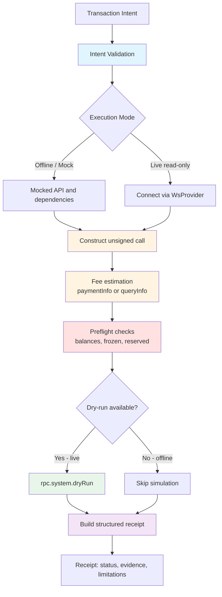

# Architecture

## Pipeline Overview

**Key distinction:**

- **Offline / mock mode** - no network connection; mocked API and dependencies are used. No signing or submission.
- **Live read-only mode** - connects to the endpoint given by `PORTALDOT_WS_URL` (for example the Portaldot V3 testnet) and performs read-only queries only: account inspection, fee estimation, and dry-run. No signing or submission.

## Component Responsibilities

### intent.js

- `createIntent(input)` - validates and creates the intent object
- `isValidSS58(address)` - SS58 prefix 42 validation
- `validateAmount(amountStr)` - 14-decimal precision validation

### executor.js

- `inspectAccounts(intent, api)` - queries `system.account` and normalizes legacy and V3 layouts
- `constructTransferCall(intent, api)` - builds the unsigned extrinsic
- `estimateCallFee(call, signerAddress, api)` - fee estimation via `paymentInfo`, falling back to `queryInfo`
- `dryRunCall(call, signerAddress, api)` - dry-run via `rpc.system.dryRun`

### preflight.js

- `runPreflightChecks({ intent, feeEstimate, accounts }, api)` - orchestrates the preflight checks
- `validateAccountSnapshot()` - validates account data and handles the V3 `frozen` / `flags` layout
- balance sufficiency with conservative handling when the frozen breakdown is unknown

### pipeline.js

- `runExecutionPipeline({ intent, api, deps })` - orchestrates the full flow
- manages the connection lifecycle and attributes errors to a pipeline stage

### receipt.js

- `createExecutionReceipt()` - builds a JSON-serializable receipt with evidence and limitations
- status mapping: `PLANNED` -> `FEE_ESTIMATED` -> `SIMULATION_PASSED` / `SIMULATION_FAILED`

## Safety Guarantees

- No transaction signing, broadcasting, or submission
- Monetary values are calculated with `BigInt` and serialized as strings
- Conservative reporting when runtime semantics are uncertain
- Limitations are recorded explicitly in every receipt
